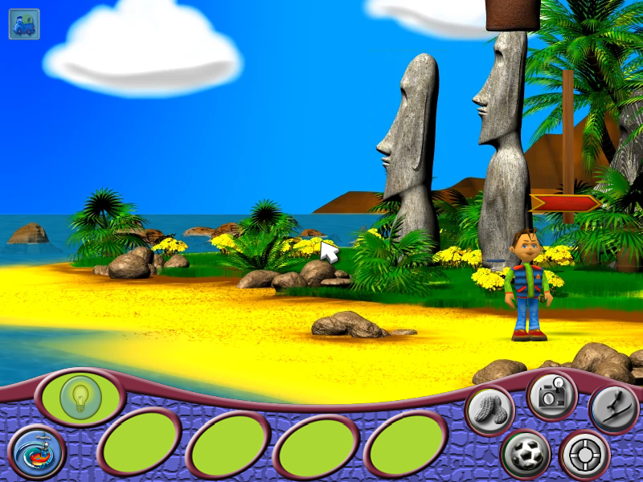

# Vahva Reis veebibrauseris

*Eksperimentaalne projekt*

Käesolev projekt on eksperiment, mille eesmärk oli välja selgitada, kas 2004. aastal eesti keeles ilmunud lastele mõeldud seiklusmängu „Vahva Reis“ on võimalik tänapäevases veebibrauseris uuesti tööle panna, kasutades selleks üksnes mängu originaalfaile. „Vahva Reis“ on Poola stuudio Rebelmind 2003. aasta mängu „Wielka Wyprawa“ eestikeelne väljaanne, mille avaldas ASECOM AS sarjas „Parimad arvutimängud eesti keeles“.

*Lihavõttesaare rand mängu brauseriversioonis.*

## Taust

Algne mäng on loodud Windowsi jaoks ning tugineb 2000. aastate alguse tehnoloogiale, mistõttu on selle käivitamine tänapäeva arvutites sageli keerukas. Eksperimendiga sooviti kontrollida, kas mängu on võimalik säilitada ja uuesti kättesaadavaks teha, ilma et selle sisu tuleks ümber joonistada või ümber kirjutada.

## Eksperimendi käik

1. Mängu andmearhiivid pakiti lahti ning selgitati välja nende failivormingud (3D-mudelid, taustapildid, liikumisalad, helid ja tekstid).
2. Analüüsiti mängu käivitusfaili, et mõista, kuidas algne mängumootor skripte, liikumist, heli ja kuvamist käsitleb.
3. Mängumootor kirjutati JavaScriptis uuesti. Mängu sündmustik on jäänud originaalseks: algsed Lua-skriptid käivitatakse brauseris tõlkekihi kaudu.
4. Graafika, kõne, heliefektid ja muusika teisendati brauserile sobivatesse vormingutesse.
5. Mäng mängiti läbi ning leitud vead parandati.

## Tulemus

Kõik viis peatükki – sadam, Aafrika, džungel, Lihavõttesaar ja Antarktika – on algusest lõpuni läbimängitavad koos eestikeelse kõne, muusika ja minimängudega. Mängu saab juhtida arvutis hiire ja klaviatuuriga ning nutiseadmes ekraanil kuvatavate juhtnuppudega. Mängu seis salvestatakse brauserisse.

Mängu saab proovida aadressil: https://wollymonjac.github.io/Vahva-Reis/

## Juhtimine

- **Hiire vasak klahv** – kõndimine ning esemete võtmine ja kasutamine
- **Enter** – repliigi vahelejätmine
- **Esc** – menüü
- **Tühik ja nooleklahvid** – minimängudes

Puuteekraanil on samad toimingud kasutatavad mänguvälja kõrval asuvate nuppude abil.

## Piirangud

Tegemist on katsetusega, mitte mängu ametliku väljaandega. Mäng on läbi testitud, kuid üksikud vead on siiski võimalikud; teadaolevalt esineb teatekastide servades väiksemaid graafilisi ebatäpsusi. Brauseri privaatrežiimis ei pruugi mängu seis säilida.

## Autoriõigused

Kõik õigused mängule, sealhulgas selle graafikale, tekstidele, helile ja muusikale, kuuluvad nende omanikele (Rebelmind, ASECOM AS). Eestikeelse heliriba on loonud FILM AUDIO OÜ. Eksperimendis kasutati isiklikku mängukoopiat. Projekt on tehtud mitteärilisel eesmärgil ega ole seotud mängu autorite ega kirjastajaga.
